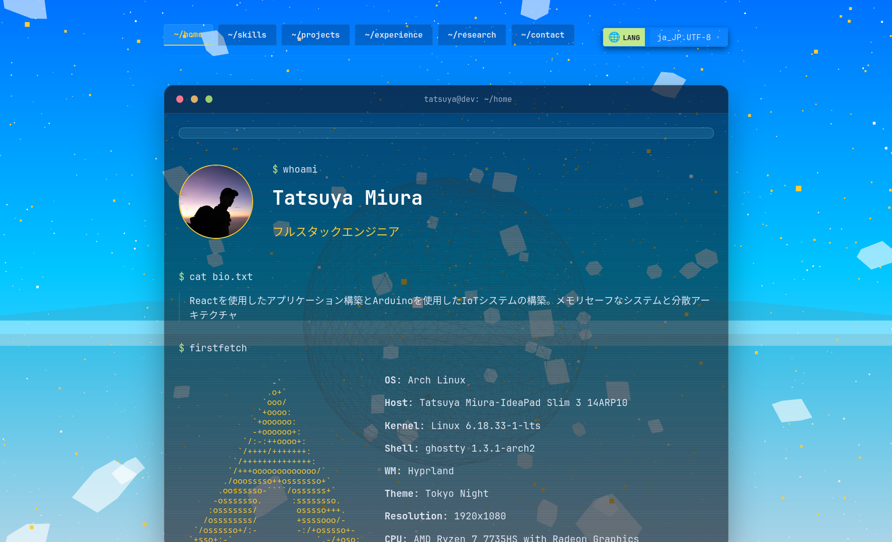

# TatsuyaM Portfolio (WASM · Hono · Bun)



A Unix-flavoured portfolio OS. The frontend is a **Rust / Leptos → WebAssembly** SPA with
aurora glass, neumorphism, a bento grid and a modal shell (Vim-style `NORMAL` / `INSERT` /
`COMMAND`). A tiny **Hono** API runs the same code on Bun, Cloudflare Workers and Cloudflare
Pages.

## ✨ Features

- **🦀 Rust + Leptos (WASM)** — no JS framework, the whole UI compiles to WebAssembly
- **🖥️ Modal shell** — `i` insert, `:` command, `?` help, `h/l` page nav, `1–6` jump, `g/G`
- **🐧 Unix engine** — `ls`, `cd`, `cat`, `tree`, `grep`, pipes (`|`), `fastfetch`, and the
  usual easter eggs (`cowsay`, `sl`, `coffee`, `cmatrix`, `sudo`, `secret`)
- **🎨 Design system** — glassmorphism + neumorphism, aurora blobs, 3 themes
  (`tokyo` / `dracula` / `nord`), reduced-motion aware
- **🌍 7 languages** — `en`, `ja`, `de`, `fr`, `it`, `ko`, `zh` (`static/locales/*.json`)
- **🚀 One API, three runtimes** — Bun (local), Cloudflare Workers + static assets, Pages Functions

## 🛠️ Tech Stack

| Layer       | Technology                                   |
| ----------- | -------------------------------------------- |
| Frontend    | Rust, Leptos 0.8 (CSR), Trunk, wasm-bindgen  |
| Styling     | Hand-written CSS (custom design tokens)      |
| Backend     | Hono 4                                       |
| Runtimes    | Bun · Cloudflare Workers · Cloudflare Pages  |
| Deploy      | Wrangler                                     |

## 📦 Requirements

- Rust + `wasm32-unknown-unknown` target
- [Trunk](https://trunkrs.dev) (`cargo install trunk`)
- [Bun](https://bun.sh) 1.3+
- (optional) `wasm-opt` for smaller release bundles

## 🚀 Quick Start

```bash
bun install
bun run dev          # trunk serve (:8080) with hot reload, /api proxied to Bun (:8787)
```

Then open <http://localhost:8080>.

Single-process preview of the built bundle (assets + API on one port):

```bash
bun run build        # trunk build --release  +  bundle the API
bun run start         # http://localhost:8787
```

## 📜 Scripts

| Script              | Description                                             |
| ------------------- | ------------------------------------------------------- |
| `bun run dev`       | `trunk serve` + Bun API in parallel (hot reload)        |
| `bun run build`     | Release WASM build + Pages Functions bundle             |
| `bun run start`     | Serve `dist/` and the API from Bun on `:8787`           |
| `bun run preview`   | `wrangler dev` (Workers + static assets)                |
| `bun run deploy`    | Build, then `wrangler deploy`                           |
| `bun run typecheck` | `tsc --noEmit`                                          |
| `bun run lint`      | ESLint                                                  |

## 📁 Project Structure

```
.
├── frontend/                 # Rust / Leptos WASM app
│   ├── src/
│   │   ├── main.rs           # entry, modal keymap, routing
│   │   ├── state.rs          # typed content, store, i18n, localStorage
│   │   ├── command.rs        # Unix command engine (pipes included)
│   │   ├── ui.rs             # topbar / statusline / drawer / help / train
│   │   └── pages.rs          # 6 bento pages + fastfetch
│   ├── styles/main.css       # design system
│   ├── index.html            # Trunk template
│   └── Trunk.toml
├── server/
│   ├── index.ts              # Hono API (Workers default + Pages onRequest)
│   └── dev.ts                # Bun dev/start server
├── static/                   # copied verbatim into dist/ (locales, icons, _headers)
├── build.ts                  # bundles the API into functions/[[path]].ts
├── wrangler.jsonc            # Workers + static assets config
└── package.json
```

## 🌍 Content & i18n

All page content lives in `static/locales/*.json` (one file per language, identical key
structure). Edit those to update copy, then rebuild. `state.rs` deserialises them into a
typed `Store`; unknown fields are ignored so new keys can be added incrementally.

## ☁️ Deploying on Cloudflare

### Workers (recommended — single deploy, assets included)

```bash
bun run build
bun run deploy
```

`wrangler.jsonc` serves `./dist` as static assets, routes `/api/*` to the Worker
(`run_worker_first`) and falls back to `index.html` for SPA routes. All response headers
(including the CSP with `'wasm-unsafe-eval'`) come from `static/_headers`.

### Pages

`build.ts` also emits a `functions/[[path]].ts` bundle so the same API runs as a Pages
Function:

```bash
bun run build
wrangler pages deploy dist --project-name <your-project>
```

### Spotify "Now Playing" (optional)

The Home page polls `/api/now-playing` and hides itself when the track is `null`. The
included endpoint is a stub; wire it to your own Spotify OAuth helper to bring the card to
life.

## 🔗 Links

- **Author**: [@TatsuyaM2667](https://github.com/TatsuyaM2667)

## 📄 License

This project is open source. See the [LICENSE](LICENSE) file for details.
